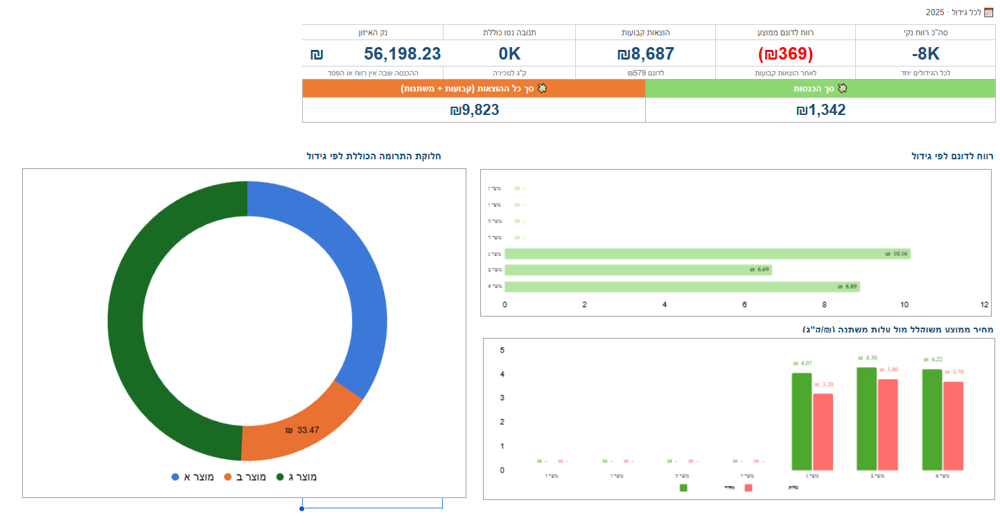
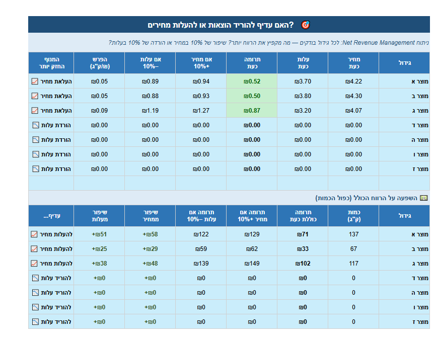
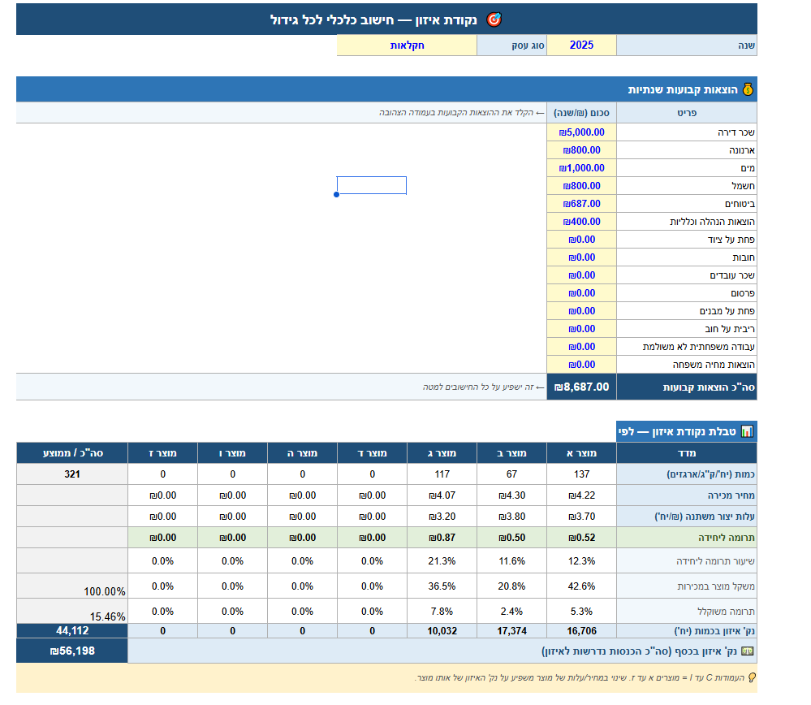
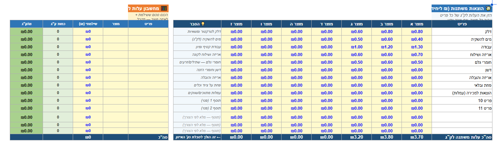
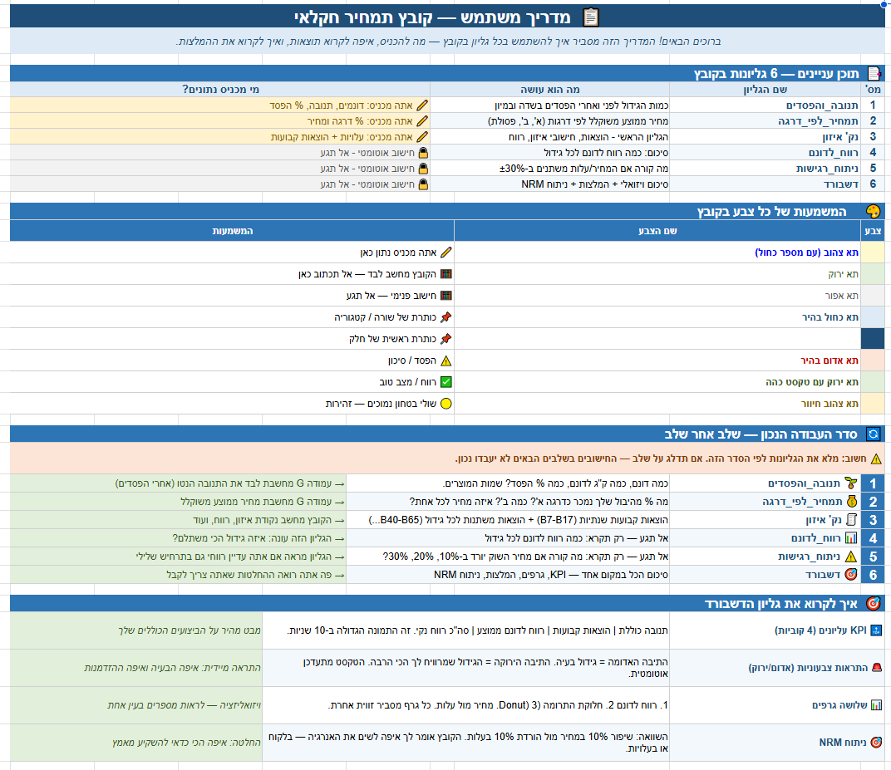

# Agricultural Costing & Break-Even Tool 🌱

### Built for MATI Northern Galilee (מט"י צפון הגליל) — a nonprofit supporting farmers and small businesses in the Galilee Panhandle

**📥 Download the tool: [`קובץ_תמחיר_חקלאי.xlsx`](קובץ_תמחיר_חקלאי.xlsx)**

## The problem

Many farmers price by gut feeling — planning around the Grade A price while ignoring Grade B, waste, field losses, and fixed costs. A crop can lose money all season without anyone noticing. MATI's advisors needed a tool a farmer with zero Excel skills could complete with them in one meeting.

Built and donated as a volunteer project.

## What it does

Six connected sheets take a farmer from raw inputs to decisions:

| Sheet | Answers |
|---|---|
| Yield & Losses | How much produce actually reaches the market |
| Pricing by Grade | What 1 kg *really* earns (weighted A / B / waste price) |
| Break-Even | How much each crop must sell to cover its costs |
| Profit per Dunam | Which crop earns the most per unit of land |
| Sensitivity ±30% | Does the farm survive a price drop? |
| Dashboard | KPIs, automatic alerts, and NRM: raise price or cut cost? |

**KPIs, red/green alerts flagging losing and winning crops, and NRM analysis:**

**Fixed costs, variable costs per kg, and contribution per crop:**

## Built like a product

Color-coded inputs (yellow = type here, green = calculated), a step-by-step Hebrew user guide, and an FAQ — no Excel knowledge required.

**Order of work, color legend, and plain-language glossary:**

## Try it

Download the file, open the **מדריך** (guide) sheet, and fill the yellow cells in order. The dashboard does the rest.

---

Built by **Ilan Metrikin** — economics & data analyst
📧 [imetrikin@gmail.com](mailto:imetrikin@gmail.com) · [LinkedIn](https://www.linkedin.com/in/ilan-metrikin-36a652218/)
